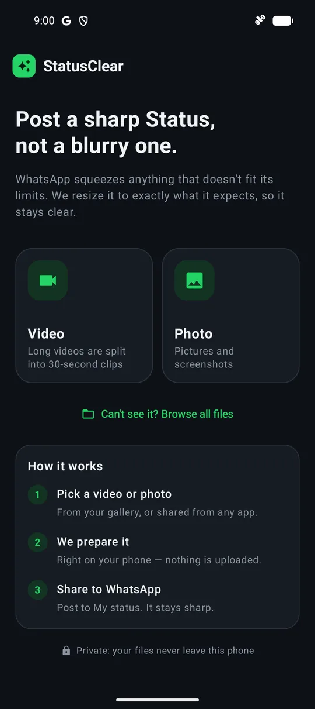
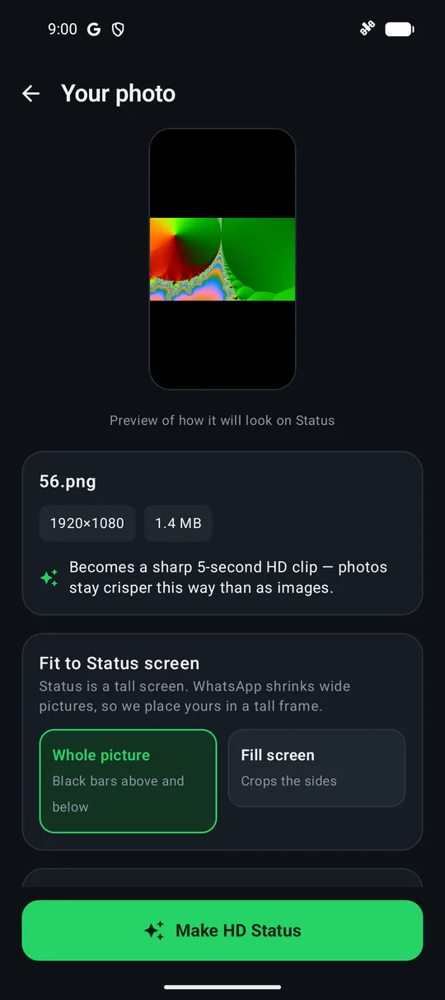
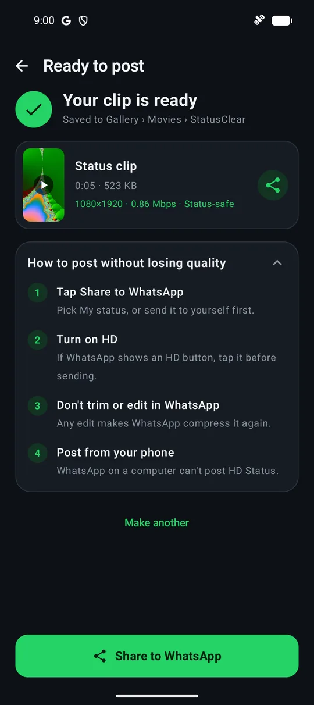

# StatusClear

**Post sharp WhatsApp Statuses, not blurry ones.** A free, open-source Android app
with no ads that prepares your videos and photos so WhatsApp Status doesn't crush them.
A free alternative to PureStatus: no ads, no in-app purchases, no account, no watermark.

Made by [Victor Conqueror](https://victor-onyemaechi.vercel.app) ([@Conqueror102](https://github.com/Conqueror102)).

[**⬇ Download the APK**](https://github.com/Conqueror102/StatusClear/releases/latest) ·
[Website](https://statusclear.hub2.workers.dev/) ·
⭐ Star the repo if it helps you

  
  
  

## Why your Status gets blurry

WhatsApp re-encodes any Status upload whose **average bitrate is above ~1.4 Mbps**,
and when it does, it shrinks it all the way down to **360×640**. That is the blur.
Chat is more forgiving (~2.1 Mbps), which is why a video can look fine when you send
it to someone but terrible as a Status.

Measured on a real phone with labelled test clips (Nov 2026):

| Where | Kept untouched | Re-encoded |
|---|---|---|
| Chat (HD) | 1.1 · 1.6 · 2.1 Mbps | 3.0 · 4.0 Mbps → 720×1280 |
| **Status** | 1.12 · 1.15 · 1.27 · 1.39 Mbps | 1.53 · 1.56 · 2.1 · 3.0 · 4.0 Mbps → **360×640** |

## What StatusClear does

- **Stays under the Status limit.** Every clip averages ≤ 1.3 Mbps, checked after
  encoding — and re-encoded lower automatically if it isn't.
- **Uses x264**, a high-quality software encoder that looks far better at ~1 Mbps
  than the phone's built-in encoder.
- **Full-HD portrait frame (1080×1920).** Wide pictures get *Whole picture*
  (black bars) or *Fill screen* (crop the sides).
- **Long videos** are split into 30-second clips, in order. 60 fps is reduced to 30,
  HDR is converted to normal colours, phone rotation is handled.
- **Photos & screenshots** become a crisp 5-second clip, with an optional
  "Zoom into text" for small writing.
- **Private.** Everything happens on your phone. No account, no uploads, no tracking.

## Install

1. Download the APK from the [latest release](https://github.com/Conqueror102/StatusClear/releases/latest):
   - `StatusClear-arm64-v8a.apk` — for almost every phone from the last 7+ years.
   - `StatusClear-armeabi-v7a.apk` — only for older 32-bit phones.
2. Open it. Android will ask you to allow installing from your browser or file
   manager — allow it, then tap **Install**.
3. Android 8.0 or newer is required.

## How to post

**Quickest (v1.4+): three taps from your Gallery.**

1. In your Gallery, tap **Share** on a video or photo and choose **HD Status**.
   A small sheet prepares it; StatusClear itself doesn't even open.
2. WhatsApp opens by itself: choose **My status** and send.
3. Don't trim or edit it inside WhatsApp — editing makes WhatsApp re-encode it.

**With more options:** open StatusClear, pick a video or photo (choose *Whole picture*
or *Fill screen*, or *Zoom into text*), tap **Make HD Status**, then **Share to WhatsApp**.

## Build from source

Requirements: Android Studio (bundled JDK) and Android SDK platform 37.

    ./gradlew assembleDebug      # one APK per CPU type in app/build/outputs/apk/debug/

For a signed release, create a `signing.properties` file next to `settings.gradle.kts`
with `storeFile` / `storePassword` / `keyAlias` / `keyPassword`, then run
`./gradlew assembleRelease`. Never commit `signing.properties` or your keystore.

Toolchain: Gradle 9.9.2, Android Gradle Plugin 9.5.3, Kotlin 2.3.21,
Compose BOM 2026.09.00, FFmpeg + x264 via `com.antonkarpenko:ffmpeg-kit-full-gpl` 2.3.0.

### What's inside (`app/src/main/java/com/example/statusclear/`)
- `MainActivity.kt` — pickers, share-in from other apps, sharing to WhatsApp.
- `StatusViewModel.kt` — screen state, background encoding, cancel.
- `StatusClearUi.kt` — all Compose screens and the theme.
- `Transcoder.kt` — probing, FFmpeg/x264 commands, the Status bitrate cap and
  re-check, 30 s splitting, saving to Movies/StatusClear.

## License

[GPL-3.0](LICENSE). StatusClear uses FFmpeg with the x264 encoder, which are GPL
licensed, so the app is GPL too: you may use, change and share it, as long as you
share your changes under the same license.

*StatusClear is an independent project and is not affiliated with, endorsed by,
or sponsored by WhatsApp, Meta or PureStatus. WhatsApp and PureStatus are trademarks of their owners.*
